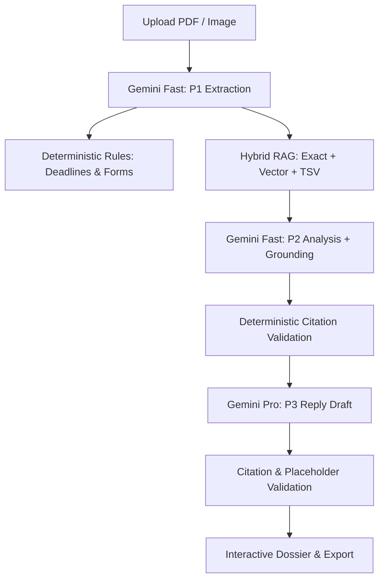

# NoticeSaathi — Build Plan

## 1. Executive Summary & Architecture
NoticeSaathi is a copilot for Indian GST notices (ASMT-10, DRC-01, DRC-01A, REG-03, REG-17, GSTR-3A, and OTHER fallback).
In ~60 seconds, an uploaded notice PDF/image returns:
1. Structured field extraction with confidence scores and verbatim evidence quotes.
2. Statutory rules mapping and deterministic code-computed deadlines (calendar vs working days).
3. Hybrid RAG legal retrieval (exact section match + vector search + full-text search) fused with Reciprocal Rank Fusion.
4. Plain-language summary (English + Devanagari Hindi), severity rating, what the officer wants, and actionable checklist.
5. Grounded draft reply letter citing verified statutory source chunks `[[chunk_id]]` with `[ADD: ...]` placeholders for missing factual records.

## 2. Milestone Execution Roadmap

### M1: UI Inventory, Mapping, Scaffolding & Setup
- Inspect Google Stitch UI export (`stitch_export/`) and document screen-to-route mappings in `docs/UI_MAP.md`.
- Extract typography (`Plus Jakarta Sans`, `JetBrains Mono`, `Noto Sans Devanagari`) and color palette (`slate-50`, `#0f172a`, `sky-600`, etc.) into Next.js Tailwind theme.
- Update `package.json` scripts (`typecheck`, `test`, `ingest`, `eval`, `contract-check`, `validate-fixtures`, `try-notice`).
- Verify complete directory structure and commit with `ai: M1 plan and UI inventory`.

### M2: Database Schema, Client & Mock Data Fixtures
- Harden Supabase schema in `supabase/migrations/001_init.sql` with pgvector HNSW + GIN indexes, RLS enabled on all tables, and `notice-uploads` private storage bucket.
- Server-side DB client with anonymous session cookie helper (`httpOnly`, `sameSite: lax`, 30-day lifetime).
- Health check route `GET /api/health`.
- Sync and validate `contracts/types.ts` schemas (allowing numbers or null for amount demanded, and proper contract definitions).
- Move and verify realistic fixtures in `src/mocks/` (covering `processing-extracting`, `processing-drafting`, `done-asmt10`, `done-drc01`, `done-low-confidence`, `done-deadline-mismatch`, `done-other-type`, `failed`).

### M3: Notice Rules Engine & Knowledge Base Ingestion
- Create `data/notice_rules.json` with working assumptions for all 6 notice types + OTHER.
- Implement `src/lib/rules/index.ts` with `loadRules`, `getRule`, and `computeReplyDeadline` handling calendar vs. working days (skipping Sat/Sun).
- Unit test suite for rules covering leap years, month-ends, working days, and invalid dates.
- Author official CBIC knowledge base files in `data/kb/*.md` across CGST Act, Rules, Forms, and non-statutory explainers.
- Build idempotent ingestion script `scripts/ingest-kb.ts` with chunking (250-350 tokens), 768-dim embeddings via `@google/genai`, and database upsert.
- Implement hybrid retrieval `src/lib/rag/retrieval.ts` with exact section lookup, vector search, TSV search, section normalization, and reciprocal rank fusion.

### M4: Gemini AI Pipeline, Prompts & API Routes
- Implement robust AI client `src/lib/ai/client.ts` with 45s timeout, Zod validation, retry logic on schema error, and exponential backoff for 429s.
- Author prompt modules with strict Zod schemas in `src/lib/prompts/` (P1 Extract, P2 Analyze, P3 Draft, P4 Claim Check).
- Author citation validator `src/lib/validation/citations.ts` with adversarial unit tests.
- Build pipeline orchestrator `src/lib/pipeline/orchestrator.ts` supporting Next.js `after()` async execution and stepwise polling fallback.
- Implement all API routes with session isolation, Zod validation, rate limiting, and standard error handling:
  - `POST /api/notices`
  - `POST /api/notices/[id]/analyze`
  - `GET /api/notices/[id]`
  - `POST /api/notices/[id]/draft`
  - `GET /api/notices/[id]/export`
  - `POST /api/notices/[id]/review-link`
  - `GET /api/review/[token]` & `POST /api/review/[token]/comment`
  - `DELETE /api/notices/[id]`
  - `GET /api/cron/cleanup`

### M5: Synthetic Test Samples & CLI Verification
- Generate three watermarked synthetic notice PDFs in `samples/` (`asmt10.pdf`, `drc01.pdf`, `reg03.pdf`) stamped "SPECIMEN FOR TESTING ONLY".
- Create prompt injection adversarial PDF and a blurry notice image.
- Build test runner script `scripts/try-notice.ts` to upload, analyze, poll, and print formatted outputs.

### M6: UI Integration & Screen Implementation
- Build centralized `src/lib/api-client.ts` as the single gateway for all network calls with mock mode toggle (`NEXT_PUBLIC_USE_MOCK=true`).
- Convert Stitch UI components into Next.js App Router pages:
  - Home (`src/app/page.tsx`): drag-and-drop intake, client name, consent line, recent notices docket.
  - Notice Dossier (`src/app/notices/[id]/page.tsx`): live progress stepper, tabs for Overview, Extracted Details, Checklist & Action Plan, Draft Reply, and Sources.
  - Shared Review Page (`src/app/review/[token]/page.tsx`): masked GSTIN, read-only view, comments.
  - Static pages: `/pricing`, `/how-it-works`, `/privacy`.
- Interactive features: citation chips with popovers, placeholder checklist review before DOCX/MD export, review link modal, delete dialog.

### M7: Evaluation Suite & Contract Validation
- Create test ground truth cases in `evals/cases/*.json`.
- Implement evaluation harness `evals/run.ts` outputting `evals/report.md` (accuracies, citation validities, latencies, token costs).
- Implement `scripts/contract-check.ts` to validate live and mock payloads against `contracts/types.ts`.

### M8: Hardening, Security, Verification & Documentation
- Comprehensive security review: prompt injection protection, session isolation, GSTIN masking, secret scanning.
- Polish `README.md`, update `docs/DECISIONS.md`, finalize `docs/AI_USAGE.md`, and compile `docs/HUMAN_TODO.md`.
- Verify full test suite, typecheck, lint, and build.
